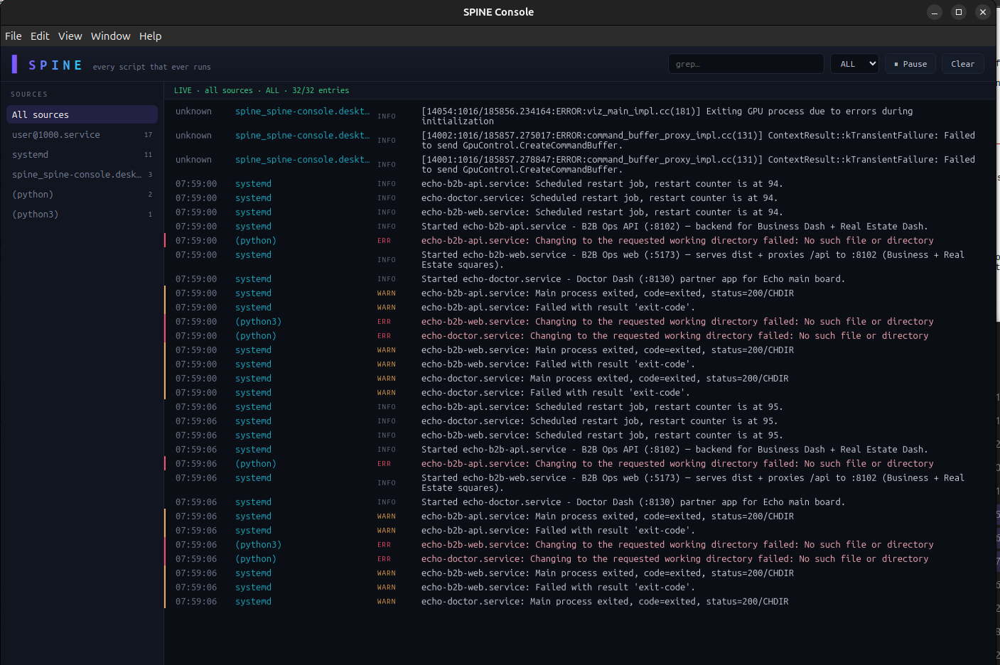
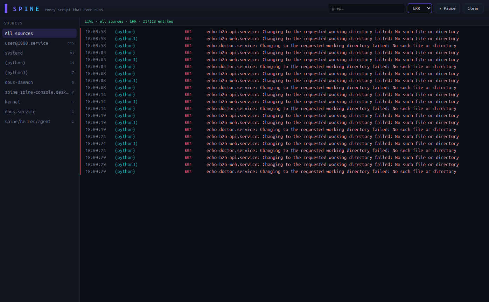
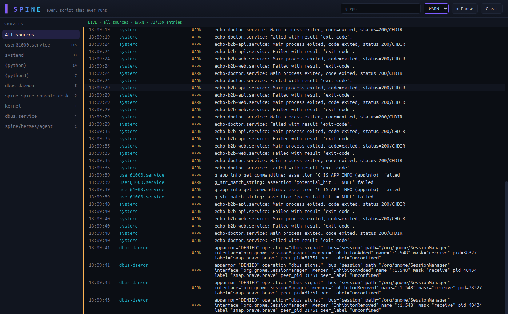
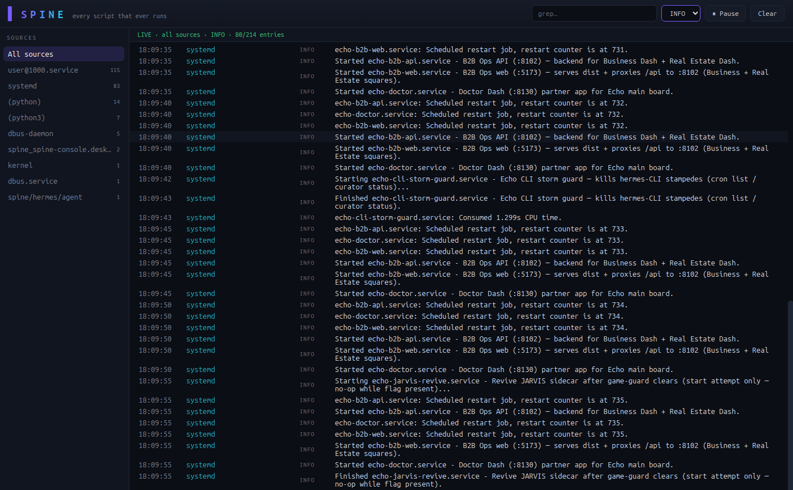
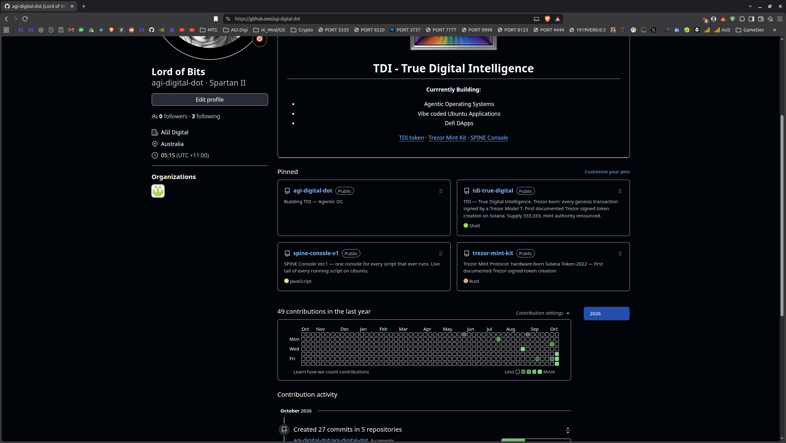

# SPINE Console Ver.1


SPINE Console is a log viewer for Ubuntu that shows you the tail end of every running script, live.

Free and open-source for anyone to download and use on Ubuntu (Linux OS) 

THE PROBLEM:

I never felt entirely safe using my Linux Operating System, being a new user of Ubuntu user in the age of AGI & AI. 

Especially when I run all sorts 'Cron jobs' (auto scripts) automatically with Hermes agent in the background.

THE SOLUTION:

- This app is a visual console that scan every live script that ever runs on your Ubuntu OS. 

- You can separate into script categories, or isolate the window to one entity. 

You can sort by:
ALL 
INFO
WARN
ERROR

- Its a live tail of every running script, you can pause and copy to feed to your AI agent to fix. 

- And you can connect it to your Local or Cloud OS Agents on Ubuntu simply telling them where the app is when its open. 
________

Disclaimer: 
This is Agentic assist and coded with my EchoULTRA AI agent- please check the GitHub, ive been using it myself daily. Please feel free to roast me, give me tips on better GitHub workflow, or any security flaws I might have.

I'm an Agentic Engineer and I understand Scripts and the functions inside them achieve success. I'm 6 months new to Ubuntu 24.04 and loving it.

This ver.1 of the app, and works for my Ubuntu OS and integrates with my ai local and cloud agent models, who use it themselves for alot of my Agentic OS building and review processes.


## What it looks like

All sources, live:



Filter by level. Errors only:



Warnings:



Info:




## Install (Ubuntu 22.04 / 24.04)

Grab the release — zip and snap included:



[Download from the releases page](https://github.com/TDI-true-digital-intelligence/T.D.I-Labs-Visual-Spine-Console-UI-Ubuntu-App-v1/releases/tag/v1.0.2)

Or from source:

```bash
./install.sh
```

That installs three commands:

| Command | What it does |
|---|---|
| `spine-run` | run any command, output saved to the journal under a tag |
| `spine-cat` | pipe any stream into the journal |
| `spine-tail` | read it all back live (Rust, fast) |

For the console window:

```bash
cd electron-app
npm install-scripts approve --all
npm install
npm start
```

Full walkthrough with screenshots: [TUTORIAL.md](TUTORIAL.md)

## Usage

```bash
spine-run backup.sh                  # run something, keep its output
spine-run --tag deploy ./deploy.py   # tag it
./train.sh | spine-cat training      # capture something already running
spine-tail --all                     # watch everything, live
spine-tail --all --priority err      # errors only
```

## Layout

- `python-capture/` — spine-run, spine-cat (Python)
- `rust-engine/` — spine-tail (Rust)
- `electron-app/` — the console (TypeScript)

## Tests

```bash
cd electron-app && npm test    # 24 passed
cd ../python-capture && python3 tests/test_regression.py    # 14 passed
```

50 checks green from a fresh clone. CI runs them on every push.

---

## License

SPINE Console is released under the [MIT License](LICENSE) — free to use, modify, and share.
Copyright (c) 2026 Robert Shields Jr. McDougall.

## AI-assistance disclosure

This project was built with AI assistance (agentic coding — Echo ULTRA / Master Control, a True Digital Intelligence partner).
All code is reviewed and tested by the human maintainer before release. Issues are the maintainer's responsibility —
please report them on the GitHub issue tracker.

## Privacy

SPINE stores script output in the systemd journal on your own machine. No telemetry, no analytics,
no network calls — your data never leaves your machine.

---

Built by Lord of Bits & Echo ULTRA - Master Control
