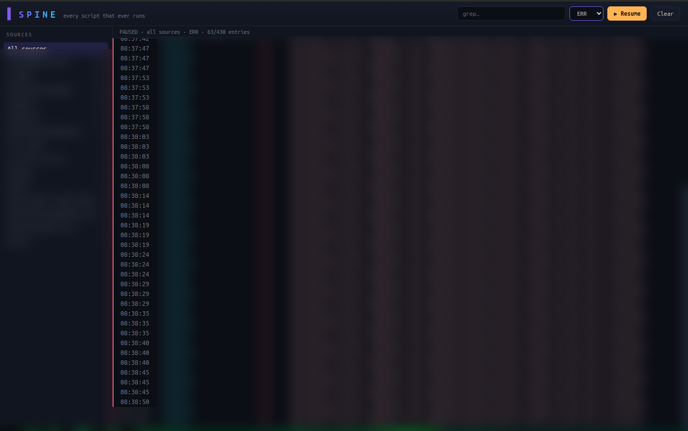
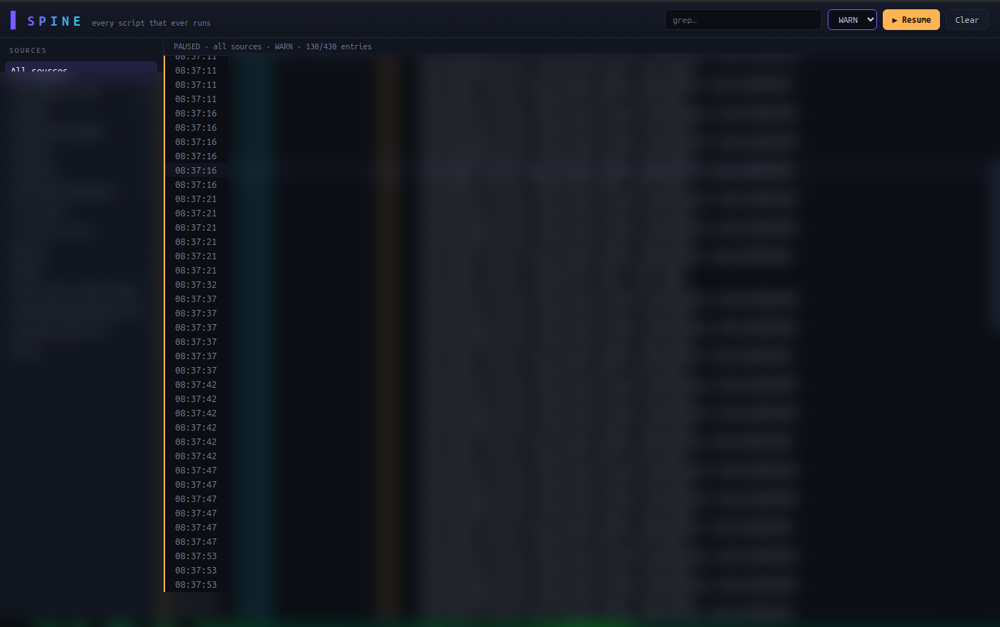
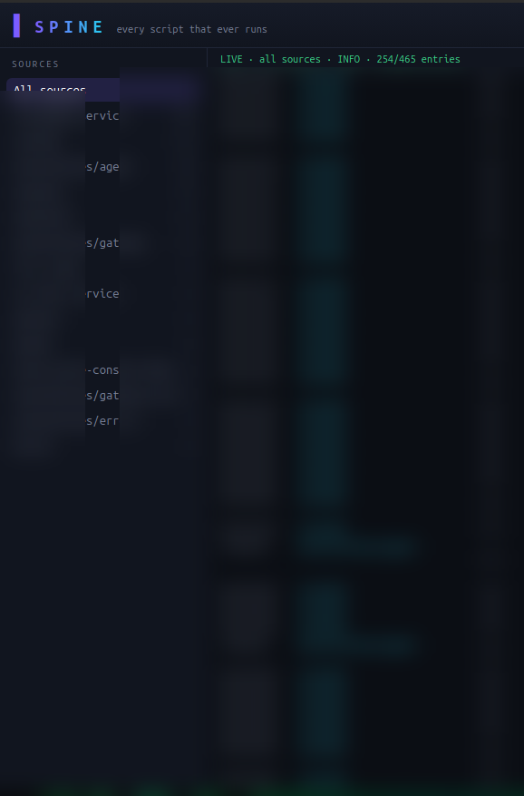
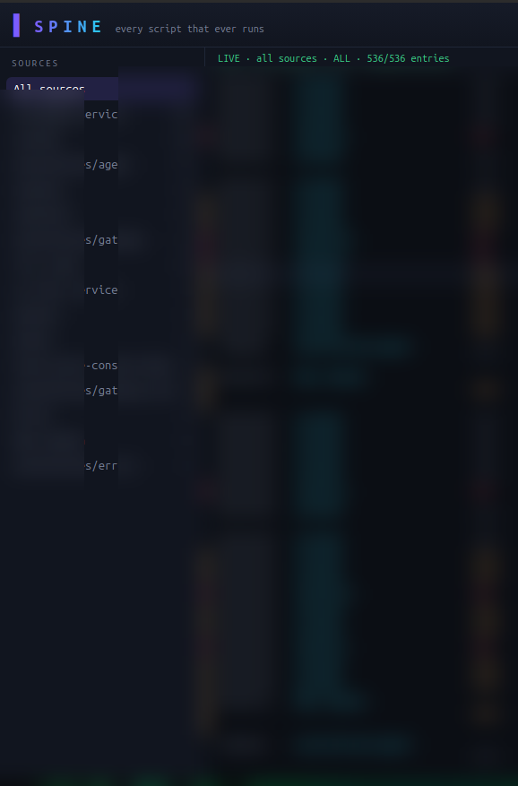
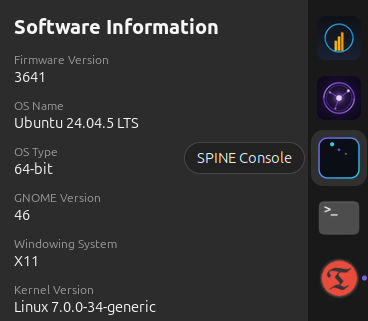
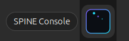

<div align="center">


# SPINE Console Ver.1

**One console for every script that ever runs.**

Output that can never be lost.

[Install](#install-ubuntu-2404) · [15-minute tutorial](TUTORIAL.md) · [Run the tests](#run-the-tests-yourself)

</div>

---

I never felt entirely safe using my Linux Operating System, being a new user of it in the age of AGI & AI – Especially when I run all sorts Local and Cloud models on my Ubuntu OS.

I vibe coded this Ubuntu (Linux OS) APP for myself, and thought id share it open-source for anyone with an Ubuntu OS. ZIP files included.

I’mnot a programmer, I just Vibe Code and understand scripts and the functions inside them enough to produce the App I want with my local and cloud models.

This is version 1, it works for my Ubuntu OS and integrates with my ai local and  models use it themselves for alot of my building and review process. 

And of course; thank you to my T.D.I Partner (True Digital Intelligence), who helped me vibe code this.  Echo ULTRA.
<div align="center">


*Live console (logs redacted) — every script that runs, streaming, searchable, forever.*

</div>

## Filter by what matters

Errors only. Warnings only. Info only. Everything. One dropdown.

| Errors only — 63 found | Warnings only — 138 found |
|:---:|:---:|
|  |  |

| Info stream — live | All levels — live |
|:---:|:---:|
|  |  |

Pause the stream, read it, resume — without losing your place. Search everything with grep.

## Yes, it's a real installed Ubuntu app

Not a demo. Not a mockup. It installs, it registers with the system, it lives in your dock.

<div align="center">

| In Ubuntu Settings | In the dock |
|:---:|:---:|
|  |  |

</div>

## The three tools

| Tool | What it does |
|---|---|
| `spine-run` | Run any command — every line of output journaled under a tag |
| `spine-cat` | Pipe any already-running stream into the journal |
| `spine-tail` | Fast Rust engine — reads it all back, live, as JSON lines |
| **SPINE Console** | The window: sources sidebar, live stream, filters, grep, pause |

## Install (Ubuntu 24.04)

**From source (~2 min):**

```bash
./install.sh
```

**Launch the console:**

```bash
cd electron-app
npm install-scripts approve --all   # one-time: new npm security default
npm install
npm start
```

**From the snap (when published):**

```bash
snap install spine
spine.console
```

New here? **[TUTORIAL.md](TUTORIAL.md) — the 15-minute picture guide.** Every step proven
from a fresh clone.

## Run the tests yourself

```bash
cd electron-app && npm test          # 24 passed
cd ../python-capture
python3 tests/test_regression.py     # 14 passed
python3 tests/test_regression_v2.py  # 5 passed
python3 -m pytest tests/test_capture.py -q   # 7 passed
```

50 checks, all green from a fresh clone. CI runs them on every push.

## What's inside

| Part | Language | Role |
|---|---|---|
| `python-capture` | Python | `spine-run` · `spine-cat` — the catchers |
| `rust-engine` | Rust | `spine-tail` — the fast reader |
| `electron-app` | TypeScript | The console window |

## The console

- **Sources sidebar** — every unit + tag discovered in your journal
- **Live stream** — entries as they arrive, newest on top
- **Filters** — source, priority, text search (grep semantics)
- **Error highlighting** — err red, warning yellow
- **Pause / resume** — without losing your place

---

<div align="center">

Built by [AGI Digital](https://github.com/agi-digital-dot) —
with a human who set the direction and a True Digital Intelligence partner that engineered
until it worked.

[TDI token](https://github.com/agi-digital-dot/tdi-true-digital) ·
[Trezor Mint Kit](https://github.com/agi-digital-dot/trezor-mint-kit)

</div>
