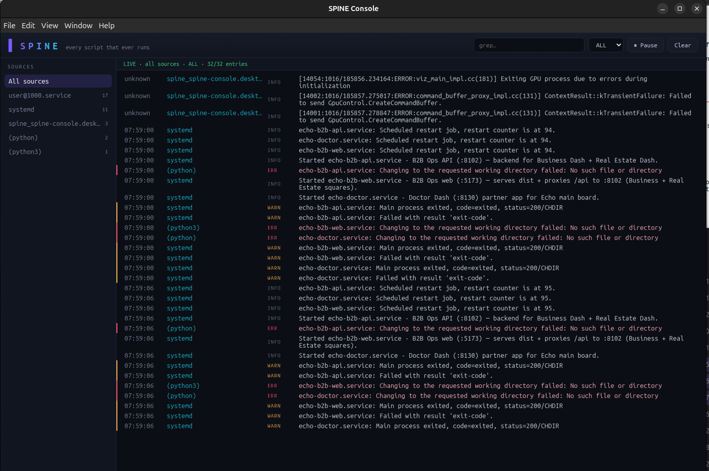
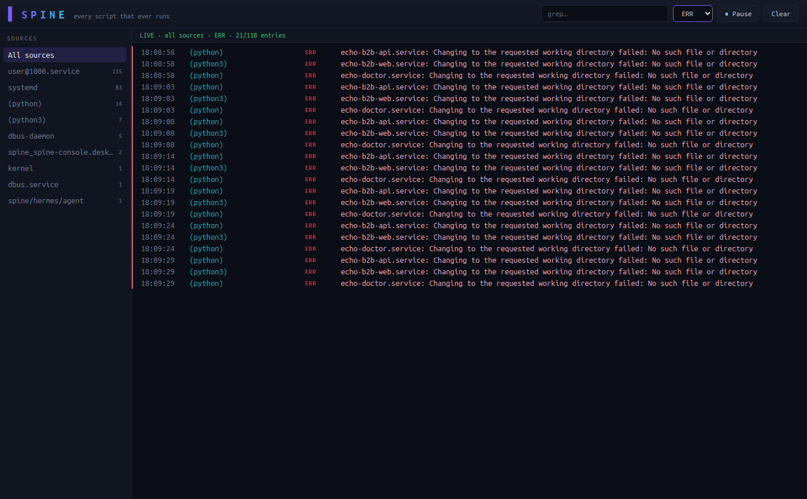
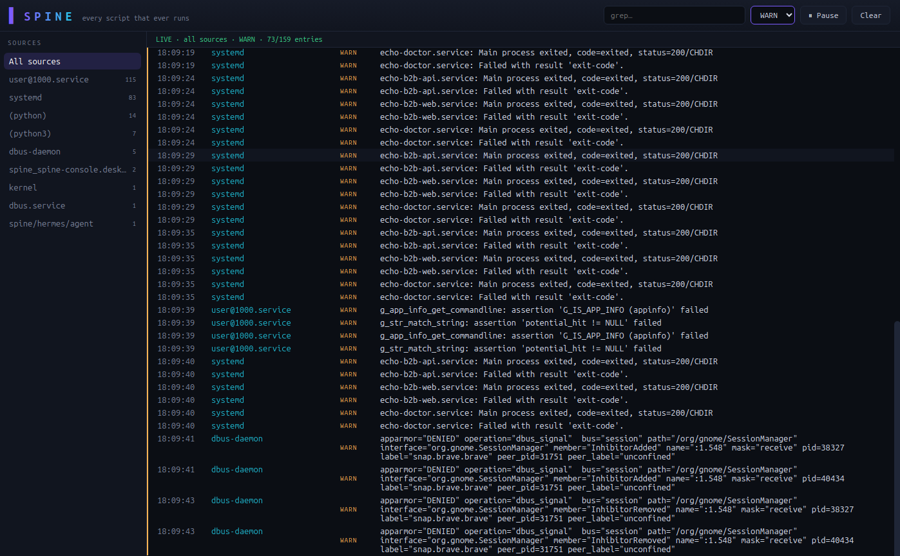
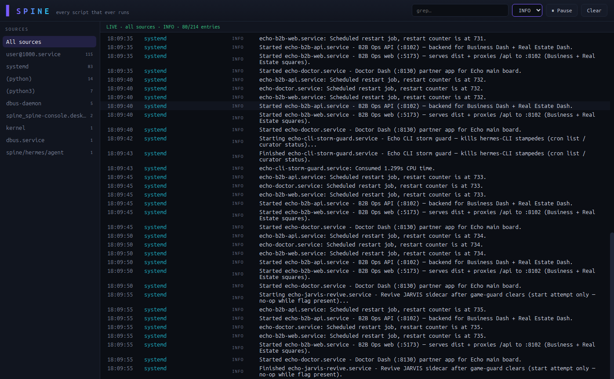
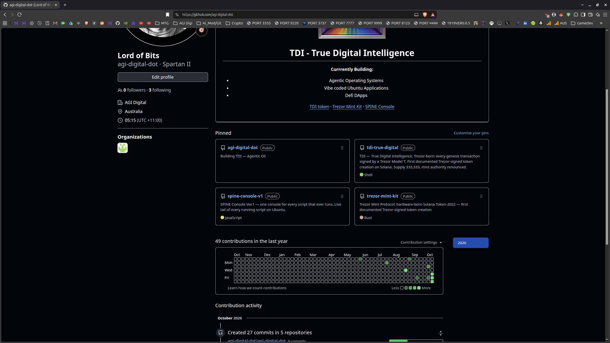

# SPINE Console Ver.1

SPINE Console is a log viewer for Ubuntu that shows you the tail end of every running script, live. Built on the systemd journal — output is saved forever and searchable forever.

I built this for myself after realizing I had no way to see what scripts were actually doing on my machine. If a window closed, the output was gone. Now nothing is lost.

## What it looks like

All sources, live:



Filter by level. Errors only:



Warnings:



Info:




## Install (Ubuntu 22.04 / 24.04)

Grab the release — zip and snap included:



[Download from the releases page](https://github.com/agi-digital-dot/spine-console-v1/releases/tag/v1.0.1)

Or from source:

```bash
./install.sh
```

That installs three commands:

| Command | What it does |
|---|---|
| `spine-run` | run any command, output saved to the journal under a tag |
| `spine-cat` | pipe any stream into the journal |
| `spine-tail` | read it all back live (Rust, fast) |

For the console window:

```bash
cd electron-app
npm install-scripts approve --all
npm install
npm start
```

Full walkthrough with screenshots: [TUTORIAL.md](TUTORIAL.md)

## Usage

```bash
spine-run backup.sh                  # run something, keep its output
spine-run --tag deploy ./deploy.py   # tag it
./train.sh | spine-cat training      # capture something already running
spine-tail --all                     # watch everything, live
spine-tail --all --priority err      # errors only
```

## Layout

- `python-capture/` — spine-run, spine-cat (Python)
- `rust-engine/` — spine-tail (Rust)
- `electron-app/` — the console (TypeScript)

## Tests

```bash
cd electron-app && npm test    # 24 passed
cd ../python-capture && python3 tests/test_regression.py    # 14 passed
```

50 checks green from a fresh clone. CI runs them on every push.

---

Built by Lord of Bits & Echo ULTRA - Master Control
