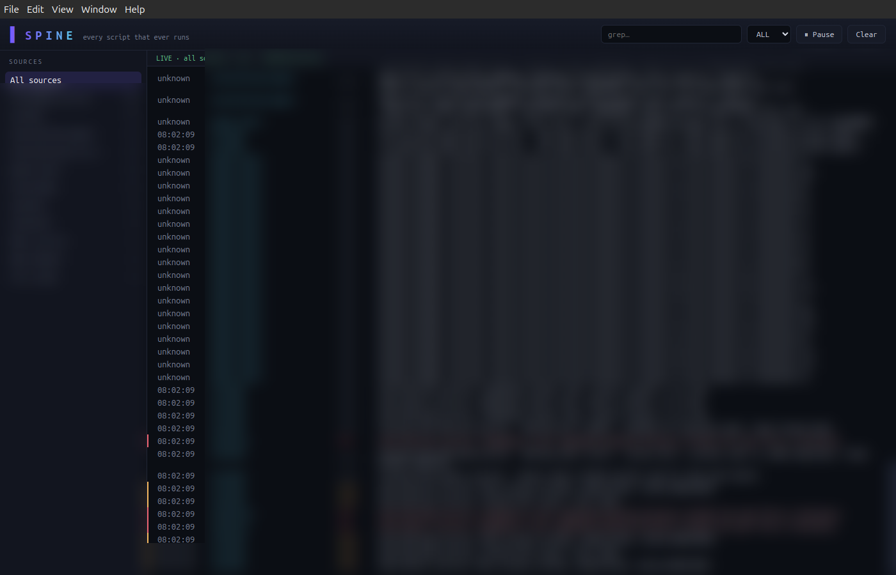

# SPINE Console


One console for every script that ever runs. Output that can never be lost.



*Live console, logs redacted — every script that runs, streaming, searchable, forever.*


You run a script. The window closes. Where did the output go? With SPINE: into the system
journal — saved forever, searchable forever, streaming live in one console window. Works for
anything: shell scripts, build jobs, long-running bots, cron tasks.

- `spine-run` — run any command, output journaled under a tag
- `spine-cat` — pipe any stream into the journal
- `spine-tail` — fast engine that reads it all back, live
- **The Console** — an Electron window: live stream, source list, grep, pause

New here? **[TUTORIAL.md](TUTORIAL.md) — the 15-minute picture guide.** Every step proven
from a fresh clone.

|---|---|
| `python-capture` | Python | `spine-run` (run anything, output journaled) · `spine-cat` (pipe into journal with a tag) |
| `rust-engine` | Rust | `spine-tail` — high-performance journal follower. Reads the journal (or stdin in offline mode), emits JSON lines: one per entry |
| `electron-app` | TypeScript | SPINE Console — sources sidebar, live stream, filters, search, error highlighting |

## Install (Ubuntu 24.04)

### From source (3 layers, ~2 min)

```bash
./install.sh          # installs Rust engine + Python CLI to ~/.local
```

Then launch the console:

```bash
cd electron-app
npm install && npm run build && npm start
```

### From the snap (when published)

```bash
snap install spine
spine.console
```

## Usage — 60-second tour

```bash
# 1. Run anything, output captured forever
spine-run backup.sh
spine-run --tag deploy ./deploy.py

# 2. Pipe anything already running
./train.sh | spine-cat training

# 3. Watch EVERYTHING live
spine-tail --all

# 4. Just one source
spine-tail --unit sol-eth-bot

# 5. Errors only, everything
spine-tail --all --priority err

# 4. Console UI
spine.console
```

## The console

- **Sources sidebar** — every unit + tag discovered in your journal
- **Live stream** — entries as they arrive, newest on top
 pause,
- **Filters** — source, priority, text search (`--grep` semantics)
- **Error highlighting** — err/red, warning/yellow
- **Pause / resume** stream without losing your place

## Layout

```
spine/
├── rust-engine/     # cargo — spine-tail binary
├── python-capture/  # spine-run, spine-cat CLIs
├── electron-app/    # SPINE Console
├── install.sh       # one-shot installer
└── snapcraft.yaml   # snap packaging
```

## Requirements

- Ubuntu 24.04 (any systemd box)
- Rust (rustup), Node 20+, Python 3.10+
- The console needs X11/Wayland; the engine and capture CLIs are headless-safe

## License

Private — built for Rob's box by ECHO.
