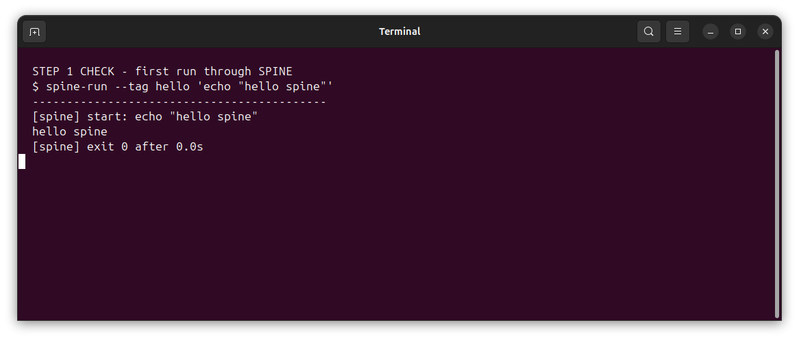
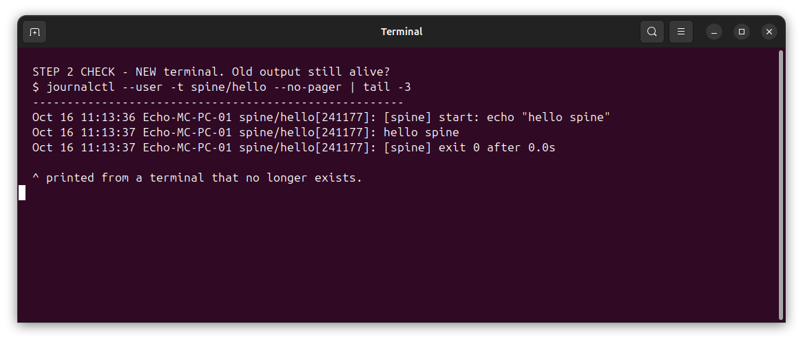
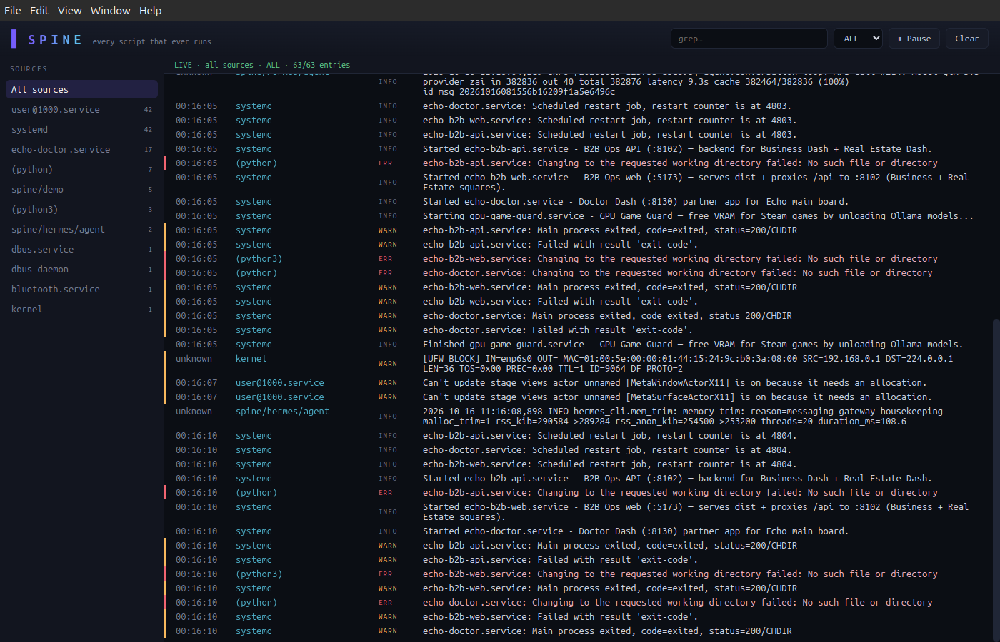
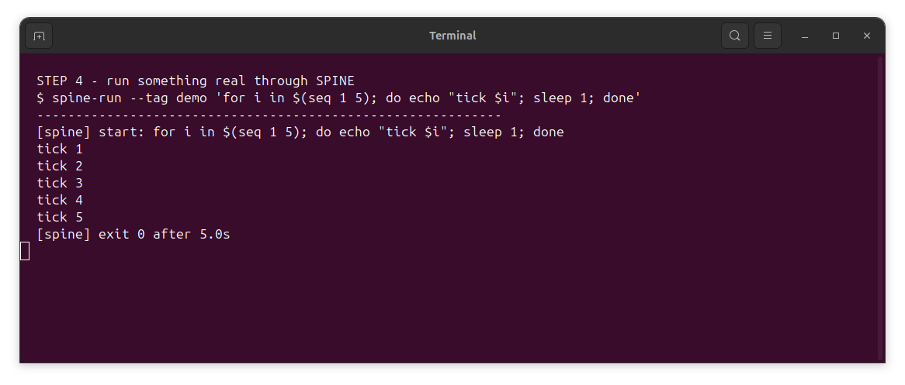
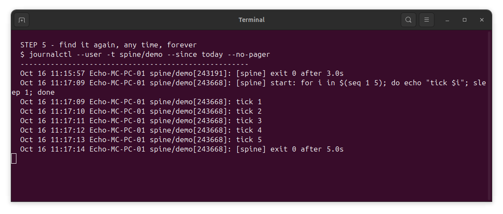

# SPINE Console Ver.1 - Ubuntu OS APP

Thank you Echo - My T.D.I Partner (True Digital Intelligence), who helped me vibe code this. 
Echo ULTRA.


| Thing | Why |
|---|---|
| Ubuntu 22.04 or 24.04 | everything here is built for it |
| Terminal (`Ctrl+Alt+T`) | where the commands go |
| About 2 minutes | seriously |

---

## Step 1 — Install it (2 min)

```bash
cd ~/spine-console
./install.sh
```

That puts three tools in `~/.local/bin`:

| Tool | What it does |
|---|---|
| `spine-tail` | the engine — reads the journal, streams it |
| `spine-run` | run any command through SPINE |
| `spine-cat` | pipe anything into the journal |

Check it worked:

```bash
spine-run --tag hello 'echo "hello spine"'
```

You should see your message echo back. It's now also saved forever.



---

## Step 2 — Prove nothing is ever lost (30 sec)

Close that terminal. Open a NEW one. Now ask the journal what happened:

```bash
journalctl --user -t spine/hello --no-pager | tail -3
```

There it is — the "hello spine" you ran a minute ago, in a terminal that no longer exists.
**That's the whole trick.** The output outlived the window.



---

## Step 3 — The console itself (5 min first time, 10 sec after)

The console is a window showing every script's output, live, in one place. One-time setup:

```bash
cd spine-console/electron-app
npm install-scripts approve --all    # new npm security default — approves electron's download
npm install                          # first time only (~2 min)
npm start                            # the window opens
```

You get the live console: every line from every script, streaming, with a search box
that filters everything, forever. (Proven from a fresh clone — that exact sequence
opened the window you see below.)



---

## Step 4 — Run something real through it (1 min)

Any command works. Long one? Spammy one? Doesn't matter — SPINE catches it all:

```bash
spine-run --tag demo 'for i in $(seq 1 5); do echo "tick $i"; sleep 1; done'
```

Switch to the console window: five ticks stream in, one per second, tagged `demo`.
Close the terminal mid-run — the output keeps flowing into the journal anyway.



---

## Step 5 — Find anything, ever (30 sec)

Tomorrow. Next week. The journal remembers:

```bash
journalctl --user -t spine/demo --since today --no-pager
```

Every tick. Timestamped. This is what "spine" means — the record that was always there.



---

## What's inside (for the curious)

- `python-capture/` — `spine-run` + `spine-cat` (the catchers)
- `rust-engine/` — `spine-tail` (the fast reader)
- `electron-app/` — the console window
- `snapcraft.yaml` — builds the snap package

## Troubleshooting

| Problem | Fix |
|---|---|
| `spine-run: command not found` | `source ~/.profile` (or open a new terminal) |
| Console window blank | `systemctl --user status systemd-journald` — the journal must be running (it always is on Ubuntu) |
| Old messages missing | journal retention (~2 weeks by default) — `sudo journalctl --vacuum-time=30d` to extend |

## Run the tests yourself (the "is this real" check)

```bash
cd spine-console/electron-app && npm test        # 24 passed — UI logic, parsing, engine streams
cd ../python-capture
python3 tests/test_regression.py                 # 14 passed — install shape, CLI behavior
python3 tests/test_regression_v2.py              # 5 passed + skips — source-level invariants
python3 -m pytest tests/test_capture.py -q       # 7 passed — capture semantics
```

50 checks, all runnable from a fresh clone. Skips (not failures) mean "build artifact not
present yet" — they activate after `npm run build` / `npm run package`.
